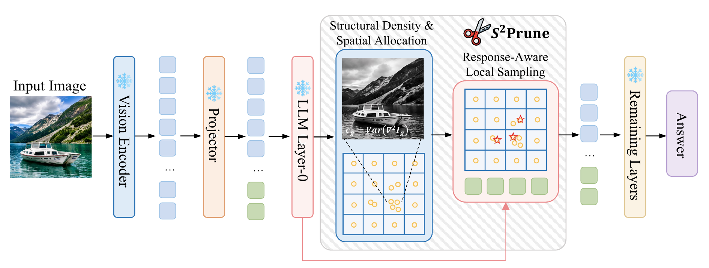

<p align="center">
  
</p>

<h2 align="center">
  S²Prune: Spatially Structured Visual Token Pruning<br>
  for Multimodal Large Language Models
</h2>

<p align="center">
  Yuanyuan Jia &nbsp;·&nbsp; Shunpu Tang &nbsp;·&nbsp; Qianqian Yang<br>
  <sub>Zhejiang University</sub>
</p>

<p align="center">
  <a href="https://arxiv.org/abs/2609.01224"><strong>Paper</strong></a> &nbsp;·&nbsp;
  <a href="#quick-start"><strong>Quick start</strong></a> &nbsp;·&nbsp;
  <a href="docs/evaluation.md"><strong>Evaluation</strong></a> &nbsp;·&nbsp;
  <a href="#citation"><strong>Citation</strong></a>
</p>

<p align="center">
  
  <br>
  <sub>Allocate tokens by spatial structure, then select informative local representatives.</sub>
</p>

**S²Prune** is a training-free method for reducing visual tokens in multimodal large language models. This release provides a fixed-budget implementation for **Qwen2.5-VL-7B-Instruct**, with physical sequence pruning after decoder Layer 0.

> **News:** S²Prune has been accepted to **WACV 2027**.

## Overview

### Method at a glance

| Stage | Operation |
| :--- | :--- |
| **Allocate** | Distribute the visual-token budget according to regional structural complexity. |
| **Select** | Keep one representative per local cell using early representation change. |
| **Compact** | Shorten the decoder sequence while preserving token order, M-RoPE coordinates, and text and special tokens. |

### Token budget profiles

The released protocol starts with **576 visual tokens** from a **672 × 672** image.

| Visual-token budget | Coarse grid | Tokens retained | Token reduction |
| ---: | :---: | ---: | ---: |
| 32 | 4 × 4 | 5.6% | 94.4% |
| 64 | 5 × 5 | 11.1% | 88.9% |
| 128 | 8 × 8 | 22.2% | 77.8% |
| 192 | 9 × 9 | 33.3% | 66.7% |

[Method and implementation details](docs/method.md) &nbsp;·&nbsp; [Released configuration](configs/qwen2_5_vl_7b.json)

## Installation

### Tested environment

| Component | Version |
| :--- | :--- |
| Python | 3.8.10 |
| CUDA | 12.1 |
| PyTorch | 2.4.1 |
| Transformers | 4.49.0 |

Use the pinned versions in [requirements.txt](requirements.txt): the pruning implementation depends on the released Qwen decoder and cache APIs.

### Set up the repository

```bash
git clone https://github.com/yuanyuanjia71-spec/S2Prune.git
cd S2Prune

python -m venv .venv
source .venv/bin/activate
python -m pip install --upgrade pip
python -m pip install -r requirements.txt
python -m pip install -e .
```

## Quick start

### 1. Select a checkpoint

| Backbone | Checkpoint |
| :--- | :--- |
| Qwen2.5-VL-7B-Instruct | [Hugging Face](https://huggingface.co/Qwen/Qwen2.5-VL-7B-Instruct) |

Set the model ID, or replace it with the path to a local snapshot:

```bash
export MODEL_PATH="Qwen/Qwen2.5-VL-7B-Instruct"
```

### 2. Run one image

```bash
python scripts/smoke_test.py \
  --model-path "$MODEL_PATH" \
  --image /path/to/example.jpg \
  --device cuda:0
```

The smoke test runs **all four budgets**. It checks the number, uniqueness, and order of selected tokens, then verifies that generation completes.

<details>
<summary>Expected token-count checks (abbreviated)</summary>

```text
PASS B=32 grid=4x4 visual=576->32 ...
PASS B=64 grid=5x5 visual=576->64 ...
PASS B=128 grid=8x8 visual=576->128 ...
PASS B=192 grid=9x9 visual=576->192 ...
```

</details>

## Evaluation

### Supported benchmarks

| Data interface | Benchmarks |
| :--- | :--- |
| Native dataset loaders | VQAv2, TextVQA, VizWiz, MMBench, ScienceQA, POPE, MME |
| Normalized JSON/JSONL manifests | MMMU, GQA, MM-Vet |

Use `--dataset MMVet` for the MM-Vet benchmark. Model weights and benchmark data are downloaded separately.

### Run a benchmark

Evaluate MMBench with a 64-token budget:

```bash
python scripts/evaluate.py \
  --model-path "$MODEL_PATH" \
  --dataset MMBench \
  --data-root /path/to/MMBench \
  --split dev \
  --mmbench-lang en \
  --budget 64 \
  --device cuda:0 \
  --output-dir outputs/mmbench_en_b64
```

<details>
<summary>Evaluate MMMU with a normalized manifest</summary>

Prepare the manifest using the [documented schema](docs/evaluation.md#normalized-manifests), then run:

```bash
python scripts/evaluate.py \
  --model-path "$MODEL_PATH" \
  --dataset MMMU \
  --manifest /path/to/mmmu_manifest.jsonl \
  --budget 64 \
  --device cuda:0 \
  --output-dir outputs/mmmu_b64
```

</details>

### Output files

| Output | Contents |
| :--- | :--- |
| `summary.json` | Aggregate scores and run metadata |
| `per_sample.csv` | Predictions, token selections, regional budgets, and timing |
| `run_config.json` | Model and evaluation parameters |
| `image_cache/` | Decoded images when required by parquet-backed datasets |

See the [evaluation guide](docs/evaluation.md) for data formats, default splits, runtime options, and benchmark-specific scoring.

## Reproducibility

Run the allocator regression checks from the repository root. These checks do not require model weights, benchmark data, or CUDA.

```bash
python -m unittest discover -s tests -v
```

The [released configuration](configs/qwen2_5_vl_7b.json) records the model, image size, token budgets, precision, and seed. Each evaluation run saves its parameters in `run_config.json`.

## Project structure

```text
S2Prune/
├── s2prune/          Allocation, selection, pruning, and data adapters
├── scripts/          Single-image checks and benchmark evaluation
├── configs/          Released model and token-budget settings
├── tests/            Allocator regression checks
├── docs/             Method and evaluation guides
├── assets/           Wordmark and method overview
└── CITATION.cff      Machine-readable citation metadata
```

## Documentation

| Resource | Contents |
| :--- | :--- |
| [Method guide](docs/method.md) | Allocation rule, selection score, sequence pruning, and source map |
| [Evaluation guide](docs/evaluation.md) | Benchmarks, manifests, commands, outputs, and reproducibility |
| [Configuration](configs/qwen2_5_vl_7b.json) | Exact settings of the released protocol |

## Citation

If you use S²Prune in your research, please cite:

```bibtex
@misc{jia2026s2prune,
  title = {S$^2$Prune: Spatially Structured Visual Token Pruning
           for Multimodal Large Language Models},
  author = {Yuanyuan Jia and Shunpu Tang and Qianqian Yang},
  year = {2026},
  eprint = {2609.01224},
  archivePrefix = {arXiv},
  primaryClass = {cs.CV},
  url = {https://arxiv.org/abs/2609.01224}
}
```

Citation-manager metadata is available in [CITATION.cff](CITATION.cff).
